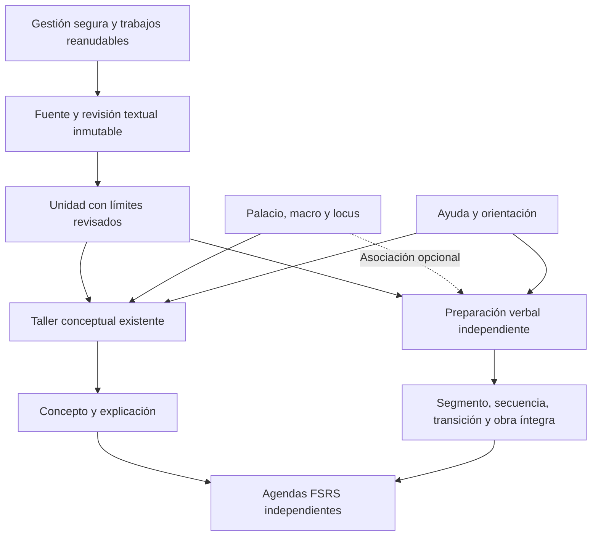

# Memorizador Solar: orientación, gestión de manuscritos y memoria literal

Estado: diagnóstico y propuesta de implementación. Base inspeccionada: `85c019e`. La Entrega 1 (orientación y ayuda, 1A/1B) se ha implementado posteriormente; consulta [funcionamiento y verificación](../guided-mode.md). Las entregas 2–4 siguen propuestas, sin implementación en esta entrega.

Este documento conserva el diagnóstico y el diseño presentados antes de cambiar contratos. Salvo la Entrega 1 indicada arriba, las funcionalidades descritas como propuestas todavía no están implementadas. No se han consultado ni modificado documentos privados de Firebase. El estado de las reglas e índices remotos no se deduce del repositorio.

## 1. Diagnóstico comprobado

La aplicación usa React 18.3.1, Vite 8.3.4, Firebase modular 10.14.1, JavaScript/JSX y CSS. El paquete local `@icarus/domain` concentra Zod, segmentación, codecs, gates y recuperación; FSRS usa `ts-fsrs@5.4.2` y codec 2. No hay backend de aplicación en el repositorio.

| Área | Implementación verificada | Reutilización y cambio necesario |
| --- | --- | --- |
| Sesión, navegación y temas | `src/App.jsx`, `src/firebase.js`, `src/components/Auth.jsx`; Firebase Email/Password y tres temas | Conservar sesión y temas. Incorporar preferencias/ayuda sin cambiar los estados del aprendizaje. |
| Lecturas | `usePrivateRead`, `privateQueries`, `readState`, `ReadNotice` | Conservar paginación de 40, cursores, aislamiento por UID y distinción entre error, caché, inválido, vacío remoto y éxito. |
| Espacios | `PalaceExplorer`, `spacesRepository`; palacios, macros y micro-estaciones | Conservar IDs, jerarquía, contadores, archivado, historial y control transaccional de ocupación. |
| Ingesta | `CognitiveLibrary`, `createSource`, `createUnit` | Original inmutable, revisión y rangos UTF-16 exactos. Hay propuestas por oraciones/versos/estrofas y selección manual. Faltan edición/versión textual e idioma elegibles; se escribe `language: und`. |
| Taller | Ocho pasos, `EncodingWorkshop`, borradores versionados y `workshopIssues` | Conservar el recorrido conceptual y su publicación atómica. Faltan introducción, niveles de ayuda y explicaciones de muchos campos y decisiones. |
| Literalidad actual | `mode: literal` crea una tarjeta `verbatim` | Sigue exigiendo concepto, fundamento/enlace, escena y examen conceptual. `unitSchema` prohíbe una unidad lista sin concepto y `encodingSchema` exige concepto y locus. Saltar formularios rompería contratos y reglas. |
| Comparación | `literalDiff` comprueba igualdad y primer carácter diferente | No alinea palabras ni identifica omisiones, añadidos o repeticiones. El reducer además aplica `.trim()` al guardar el intento: el nuevo recorrido debe conservarlo íntegro. |
| Repaso | `SteppedReview`, máquina de estados, pistas, topes y `submitReview` | Reutilizar FSRS y el protocolo de intento/evento/versiones. Faltan ejercicios de secuencia, transiciones, examen íntegro y comparación detallada. El textarea actual limita el intento a 4.000 caracteres. |
| Manuscritos | `source.lifecycle` admite `active` y `archived` en el contrato | La interfaz no ofrece archivado, restauración ni borrado. Las reglas solo permiten crear fuentes/revisiones y no autorizan su actualización o eliminación. |
| Disponibilidad para estudiar | Cola por `cards.lifecycle == active`, ordenada por `dueAt` | No consulta el estado de la fuente. Archivar únicamente `sources` no excluiría sus tarjetas ni detendría repasos o publicaciones ya abiertos. |
| Preservación | Codecs tipados, hashes, simulador de migración y respaldo del legado | Reutilizar codecs y validación. El respaldo existente es del legado y puede ser `uncoordinated`; no es un respaldo consistente del grafo completo de un manuscrito. |
| Marca | Denominación anterior en `App`, biblioteca, preparación, final de sesión y metadatos HTML | Cambiar textos públicos y nombres accesibles al finalizar la integración. Conservar paquetes, flags, rutas e identificadores internos. |

No se ha encontrado una implementación de introducción interactiva, ayuda estructurada por campo, gestión de fuentes, borrado recursivo o entrenamiento literal acumulativo. La presencia de estados en los contratos o de colecciones en la lista de lectura de Rules no demuestra que esos mecanismos existan.

## 2. Arquitectura propuesta

Se mantiene la estructura actual. Las pantallas orquestan componentes; el dominio decide segmentación, comparaciones, progresión y evaluación; los servicios ejecutan persistencia y operaciones atómicas. No se trasladará toda esta lógica a `App.jsx` ni se reemplazará el estudio clásico.

### Modo Guiado

- `GuidanceProvider` separado del estado de los borradores, intentos y scheduler. La preferencia Guiado/Normal y el estado de la introducción se guardan por cuenta en almacenamiento local versionado; si el navegador impide persistirlos se conserva la elección durante la sesión y se informa. Sin modificar `settings/profile`, que hoy es de solo lectura.
- Introducción opcional de siete pasos: palacio, macro, locus, asociación, objetivos, repaso y finalidad del Taller. Permite avanzar, retroceder, saltar, terminar y reabrir. Saltar no equivale a desactivar validaciones ni completar pasos del aprendizaje.
- Catálogo de ayuda con seis apartados por campo: significado, finalidad, acción, ejemplo, cuándo utilizarlo y consecuencia de omitirlo/cambiarlo. Se comprobará automáticamente la cobertura de campos, incluidas casillas y selectores.
- En Guiado se muestran una instrucción breve y el siguiente objetivo mental; el detalle se despliega progresivamente. En Normal permanece un control de ayuda accesible. Cambiar de nivel no modifica ni reinicia respuestas.
- Explicaciones reactivas para argumento, fundamento, enlaces y sus siete relaciones, objetivos y disponibilidad espacial. Las aristas actuales van de la idea nueva a la anterior; la ayuda debe decirlo expresamente. Para `argument_order`, documentar el sentido elegido antes de presentar una interpretación nueva de enlaces históricos.
- Mostrar también los loci no disponibles como opciones deshabilitadas con su motivo. Si un locus seleccionado se ocupa desde otra pestaña, explicar el conflicto y exigir elegir otro, conservando el borrador; nunca liberar o sustituirlo automáticamente.
- Durante una recuperación, la ayuda general no puede revelar contenido del texto o escena estudiada. Toda ayuda que dependa de la respuesta esperada debe pasar por el sistema de pistas y quedar registrada.
- Explicar Repetir como olvido/error, Difícil como recuperación correcta con esfuerzo, Bueno como correcta y razonablemente fluida, y Fácil como autónoma y fluida. No prometer intervalos fijos: dependen del historial. Explicar por qué una pista o revelación limita la nota.

La primera entrega de interfaz no necesita cambiar Firestore ni desplegar reglas o índices.

### Gestión de manuscritos y frontera de confianza

Se conserva Spark y no se requieren Cloud Functions. Para el borrado de grafos grandes se propone un backend Node limitado en Vercel, el alojamiento ya utilizado. Es una ampliación explícita de la decisión anterior de usar exclusivamente cliente y Rules; no supone cambiar el plan de Firebase.

No basta con permitir `delete` al propietario y ejecutar un bucle desde el navegador: Rules no puede demostrar que una consulta no haya omitido dependencias, el borrado no es recursivo y las relaciones pueden cambiar entre páginas.

El backend verificará el ID token de Firebase, su proyecto y propietario, y derivará el UID del token. No aceptará del navegador un UID, rutas de documentos, lotes de borrado ni resultados de inventario como autoridad. La credencial de servicio existirá solo en el servidor, con permisos mínimos de datos y verificación de identidad necesarios, nunca como variable `VITE_*` ni con rol de propietario/editor del proyecto por comodidad. Las reglas seguirán denegando el borrado directo de estas entidades desde el cliente.

Ese backend todavía no existe ni dispone de configuración de despliegue para esta función. La API key web de Firebase no lo autentica. Su ejecución se validará primero contra emuladores; la habilitación de producción exigirá configurar la identidad de servidor y desplegar el servicio y las reglas correspondientes. No se solicitarán claves privadas en el chat.

## 3. Archivado, restauración y borrado

### Archivado reversible

1. Actualizar únicamente ciclo de vida/versión de la fuente mediante una operación idempotente y un evento de ciclo de vida inmutable. No mezclar eventos administrativos con `sources/{id}/revisions`, donde están las revisiones textuales.
2. Excluir inmediatamente las fuentes archivadas de la cola ordinaria. La disponibilidad de una tarjeta depende también de la fuente, no solo del campo `cards.lifecycle`.
3. Comprobar esa disponibilidad al formar la cola, al abrir una tarjeta y dentro de la transacción/reglas que confirman un repaso o publicación. Cubrir pestañas y sesiones ya abiertas.
4. Conservar unidades, borradores, conceptos, relaciones, codificaciones, loci ocupados, fechas y snapshots FSRS. Una fuente archivada puede seguir siendo referencia válida de otra fuente.
5. Restaurar sin reiniciar agendas. Los vencimientos originales pueden hacer que reaparezcan pendientes; explicarlo. Un error al resolver el padre de una tarjeta no se tratará como fuente archivada ni como cero pendientes.

Las tarjetas v1 no tienen `sourceId`: se resuelve a través de `unitId`, con lecturas de padres agrupadas/cacheadas y estados explícitos. No se descartarán todas las tarjetas de una página simplemente porque su fuente no esté en la página visible de manuscritos. Las entidades nuevas pueden materializar `sourceId`, validado contra su referencia real; no se exige rellenarlo masivamente en documentos antiguos.

### Inventario y política de integridad

El inventario seguirá el grafo real, sin límite artificial de 40 registros:

| Entidad | Relación que debe comprobarse |
| --- | --- |
| `sources` y todas sus revisiones | Raíz, revisión activa, revisiones anteriores y subcolecciones reales. |
| `units` y revisiones | `sourceId`; original, límites y codificaciones activas/históricas. |
| `encodingDrafts` | `unitId`, incluyendo borradores publicados. |
| `encodings` y revisiones | `unitId`, `sourceRevisionId`, concepto, arista, locus y referencias del gate. |
| `concepts` y revisiones | `encodingId` y referencias primarias desde unidades. |
| `conceptEdges` | Ambos extremos, `encodingId` y `evidenceUnitIds`; no solo aristas salientes. |
| `cards` | `unitId`/`encodingId`, todos los estados y objetivos, no solo pendientes. |
| `reviewEvents` | `cardId`, incluidos eventos con respuestas opt-in. |
| `microStations` e historial espacial | Ocupación vigente, versión y contador vitalicio; el espacio se conserva. |
| Otras entidades | Inspeccionar `reviewAttempts`, `studySessions`, `spaceEvents`, enlaces/migraciones y futuras entidades literales si existen. La lista de Rules no implica que haya documentos ni define sus relaciones. |

Antes de confirmar, mostrar recuentos completos, listas paginadas por tipo y dependencias externas. Un inventario incompleto o inválido bloquea el borrado; no se presenta como cero. No se inventarán relaciones para documentos con un esquema desconocido.

Política inicial de referencias cruzadas: **bloquear el borrado si otra fuente conserva una referencia viva a un concepto, codificación o evidencia que desaparecería**. También se consideran fuentes archivadas. Informar qué fuente depende de cuál y permitir conservar el archivo. No eliminar aristas ajenas, convertir conceptos a fundacionales, duplicar conceptos ni modificar otros manuscritos silenciosamente. La reasignación/desvinculación será una operación explícita y versionada; mientras no exista, el bloqueo permanece.

### Operación reanudable

- Eliminar desde Archivados, con confirmación del manuscrito concreto y advertencia de irreversibilidad. Ofrecer exportar antes, sin prometer que el respaldo legado ya respalda este grafo.
- Generar vista previa y huella del inventario. Tras confirmar, adquirir una barrera de mantenimiento por cuenta, volver a inventariar y comprobar versiones/huella antes del primer borrado. Si cambió, pedir revisar una nueva vista previa sin eliminar nada.
- La barrera impide nuevas referencias, publicaciones y cambios del grafo mediante Rules y backend. Mantiene lectura y acceso clásico cuando no afecta al grafo. Su coste adicional en accesos/expresiones de Rules debe probarse frente a los límites; los controles no se quitarán para superar un test.
- Separar la barrera lógica de la concesión temporal del trabajador. Si vence la concesión, otro trabajador puede reanudar; **no se desbloquean escrituras sobre un grafo parcialmente eliminado** por el simple paso del tiempo.
- Trabajo persistente con fase, cursor, contadores, huella, versión y último error. Borrar en lotes acotados por cantidad/tamaño y confirmar también el avance del checkpoint de forma atómica. Reintentar un documento ya borrado es inocuo; dos trabajadores no pueden consumir el mismo checkpoint.
- Eliminar los documentos dependientes y sus subcolecciones, eventos y respuestas asociadas antes de eliminar revisiones/fuente raíz. Enumerar subcolecciones con el SDK servidor; no asumir que desaparecen al borrar su padre. Registrar solo progreso operativo, sin copiar el texto o las respuestas a un respaldo oculto.
- Liberar cada ocupación mediante transacción con versión: comprobar que el locus todavía apunta a la codificación eliminada, conservar `usageCountLifetime` y dejarlo en `cooling` con `activeEncodingId: null`. Mantener palacio, macro y su contador de loci activos. Si la ocupación cambió, detenerse; nunca borrar un anclaje nuevo.
- El descanso y la posterior reutilización serán explícitos. No imponer un número de días como ley científica. El metadato de liberación puede vivir separado para conservar el contrato v1 del locus.
- Verificar que no quedan referencias vivas ni subcolecciones del manuscrito; finalizar, liberar la barrera y conservar solo un comprobante operativo mínimo sin contenido de aprendizaje. Los snapshots históricos de espacios son historia, no punteros activos: documentar su tratamiento, sin destruir la historia de otros usos del espacio.
- Antes del primer borrado puede cancelarse sin destrucción. Después, la recuperación consiste en **reanudar hasta completar**, no en prometer deshacer una eliminación irreversible. Una restauración desde exportación sería un procedimiento separado, validado y explícito.

## 4. Evolución de contratos antes del recorrido literal

No se incrementará una constante global para reinterpretar todos los datos existentes. Habrá lectores y validadores explícitos por versión; los documentos v1 publicados siguen válidos, con sus IDs, gates, agendas e historiales originales.

| Documento/colección | Propuesta compatible |
| --- | --- |
| Fuentes v1 | Conservar forma y referencias. Archivado añade un protocolo de actualización restringido, no campos arbitrarios. |
| Revisiones textuales v2 | Original inmutable y hash, idioma, edición/versión indicada por el usuario y metadatos opcionales. Vincular ejercicios a revisión y edición concretas. Una nueva edición no sustituye la autoridad de ejercicios anteriores. |
| Unidades v2 | Objetivo conceptual/literal/combinado y estados por recorrido. Una unidad exclusivamente literal puede estar lista sin concepto ni escena. Una combinada comparte fuente y límites; cada recorrido muestra su propio estado de preparación. |
| Conceptos/codificaciones v1 | Conservar el contrato y gate conceptual. No crear conceptos ficticios para satisfacerlo desde el modo literal. |
| Asociaciones literales nuevas | Vínculo espacial opcional de segmento/grupo, con propósito de inicio, transición u orden y escena opcional. La reserva debe participar de la misma exclusión mutua que `activeEncodingId`; no crear una segunda ocupación independiente que permita colisiones. |
| `literalPrograms` | Revisión/edición, perfil de comparación versionado, configuración y orden revisado de unidades. Mantener separadores/rangos suficientes para reproducir la fuente sin reconstrucciones con espacios inventados. |
| `literalExercises` | Ámbito segmento/secuencia/transición/obra íntegra, miembros/rangos ordenados y versión del programa. Rechazar mezclas de fuentes, revisiones u orden no autorizado. |
| Tarjetas/eventos v2 | Binding explícito a ejercicio literal o codificación conceptual, `sourceId` verificable y scheduler existente. El examen íntegro y cada secuencia programada tienen agenda propia. Los eventos incluyen modalidad, perfil, ayuda, resultado y versiones; no sustituyen eventos v1. |
| `literalAttempts` | Evidencia diferenciada: intento autónomo, asistido, corregido o verificación oral manual. Por defecto conservar métricas/posiciones, sin palabras de respuesta ni diff completo; texto y diff con consentimiento explícito. |
| `sourceEvents`, `sourceOperations`, `deletionJobs` y control de mantenimiento | Protocolos administrativos separados de revisiones textuales y de `settings/profile`. Estado operativo escrito por servidor cuando corresponda; lectura solo del propietario. Manifiestos grandes deben paginarse en subcolecciones. |

El nombre exacto y la forma de la asociación espacial literal se fijarán con pruebas del protocolo: `activeEncodingId` es hoy una referencia obligatoria a un encoding conceptual. Usar ese campo para apuntar silenciosamente a otra colección sería incompatible. Se requiere una variante tipada nueva o un adaptador de binding explícito, conservando la lectura de loci v1 y la exclusión de ocupación entre ambos recorridos.

El modo combinado nuevo publica concepto/explicación por su recorrido y literalidad por el suyo sobre la misma unidad; no genera dos tarjetas verbatim para el mismo ejercicio. Los documentos combinados v1 conservan sus tres tarjetas existentes. No se reinicia ni convierte automáticamente un estado FSRS o un progreso clásico para fabricar evidencia de exactitud bajo un protocolo nuevo.

Orden de despliegue: lectores compatibles → reglas/protocolos e índices probados → nuevas escrituras detrás de flag → activación. Las pestañas antiguas deben solicitar recarga o impedir escrituras incompatibles; una flag no sustituye validaciones de servidor/Rules. Una exportación/ensayo de compatibilidad debe demostrar que v1 permanece intacto. No se ejecutarán migraciones masivas sobre las cuentas como parte del despliegue habitual.

## 5. Recorrido literal propuesto

### Preparación y práctica

1. Elegir Conceptual, Literal o Combinado al crear/preparar. Preservar texto íntegro, idioma y versión elegida. Para latín no usar otra edición como corrector.
2. Proponer versículos, versos, estrofas, oraciones o grupos rítmicos. Los números de versículo no se quitarán automáticamente: el usuario decidirá si pertenecen al texto que quiere reproducir. Revisar cortes, dividir/unir manualmente y validar orden y límites sin solapamientos. Preservar separadores y fuente original, incluidos CRLF, espacios, diacríticos y palabras repetidas.
3. Familiarización breve: leer y practicar pronunciación; ritmo/canto opcionales. Reproducir una grabación aportada cuando exista. No presuponer Cloud Storage en Spark ni añadir síntesis latina como requisito. La primera versión no necesita micrófono.
4. Asociación espacial opcional de un segmento o grupo para recordar inicio/orden/transición. No exigir imagen por palabra, premisas, conclusión, fundamento ni examen conceptual.
5. Ocultar texto, recoger intento escrito **sin `.trim()` ni normalización silenciosa**, comparar, mostrar corrección y permitir otro intento. Conservar como tal el fracaso inicial: acertar después de ver la solución no convierte ese evento en recuerdo autónomo.
6. Añadir encadenamiento acotado, inicio intermedio y pruebas de continuidad; después examen de obra íntegra. La referencia del examen es el original de su revisión, no `chunks.join(' ')`.

El MVP mantendrá inicialmente el límite de fuente actual de 60.000 unidades UTF-16, comunicado antes de guardar, sin truncar contenido. El campo de intento dejará el límite actual de 4.000 y se ajustará al ejercicio. Si se necesitan obras mayores, incorporar almacenamiento por partes inmutables y manifiesto de hashes en una entrega propia; no introducir documentos que excedan el límite de Firestore.

### Comparación verificable

- Tokenizar palabras/puntuación preservando sus posiciones en el texto; representar espacios/saltos cuando la política los exige. Mantener un resultado bruto de igualdad exacta y resultados separados de exactitud léxica y conformidad con el perfil elegido.
- Alinear secuencias con inserciones, eliminaciones y sustituciones. Detectar cambios de orden a partir de bloques alineados. Con repeticiones y alineaciones igualmente válidas, señalar ambigüedad y usar una política determinista; no atribuir como certeza una única palabra omitida si existen varias posiciones equivalentes.
- Mostrar palabras originales e intentadas, huecos, añadidos y sustituciones con etiquetas además del color. Una forma latina distinta sigue siendo distinta. Subrayar diferencias de letras/desinencias visibles sin afirmar que se ha implementado un analizador morfológico o que conoce la intención gramatical.
- Opciones explícitas y versionadas para mayúsculas, puntuación, diacríticos, espacios/saltos y convenciones ortográficas. No aplicar por defecto equivalencias i/j, u/v, ligaduras o variantes de edición. Nunca modificar el original al cambiar un perfil.
- Explicar denominador y alcance del porcentaje. Un 100 % léxico puede coexistir con puntuación diferente; solo la igualdad completa bajo el perfil exigido permite declarar conformidad, y solo sin ayudas permite calificarla como recuperación autónoma.
- Limitar recursos de alineación para obras extensas, con worker/cancelación cuando corresponda. No crear matrices cuadráticas sin límites ni presentar una comparación truncada como examen completo. Registrar que un resultado es incompleto si se agotó el presupuesto.

### Pistas, progresión y agenda

Pistas graduadas apropiadas a palabras: contexto anterior, palabra inicial y comienzo del segmento. Se solicitan tras un intento y se registran antes de exponer la ayuda. El contenido de una ayuda conceptual no servirá de sustituto del anclaje verbal. Revelar la respuesta completa o fallar no puede dar Fácil.

La progresión acumulativa será configurable: A, B, A+B, C, A+B+C, B+C es un ejemplo de producto, no un protocolo neurocientífico validado. Acotar segmentos/palabras por sesión. Practicar una transición o elegir un punto intermedio no exige recitar siempre desde el comienzo.

Reutilizar scheduler y codec existentes. Separar recuerdo exacto autónomo, correcto laborioso, asistido e incorrecto. La revisión de un segmento no acredita un examen completo; la reparación inmediata tras un error no borra el fallo ni se cuenta como una sesión espaciada independiente. Si se programa una secuencia o examen, tendrá tarjeta y estado propios.

Después del MVP escrito, ofrecer recitación oral con intento previo y comprobación manual frente al original. Guardar `verification: manual`, no una exactitud automática inventada ni un 100 % calculado sin transcripción. Reconocimiento de voz queda para una entrega posterior, opcional y con consentimiento de micrófono; una transcripción, especialmente latina, nunca será autoridad única para declarar perfección.

## 6. Fundamento histórico, evidencia y decisiones de producto

| Fundamento | Qué aporta | Límite de la afirmación |
| --- | --- | --- |
| *Rhetorica ad Herennium*, libro III, secciones sobre memoria, autor anónimo | Distinción histórica memoria rerum/verborum y soporte espacial/imaginativo | No es un ensayo experimental ni demuestra eficacia de esta implementación. |
| Quintiliano, *Institutio oratoria* XI.2 | División de material, conexión, práctica progresiva y comprobación del recuerdo | Referencia histórica para diseñar ejercicios; no validación de un calendario concreto. |
| Recitación y salmodia | Contexto para lectura, ritmo, canto y continuidad | Ritmo/melodía son opciones; sus posibles beneficios dependen de tarea/persona y no garantizan exactitud. |
| Roediger y Karpicke (2006), *Test-Enhanced Learning*, Psychological Science | Evidencia experimental de beneficios de recuperación en las condiciones estudiadas | No valida específicamente el flujo combinado ni la recitación íntegra de un cántico latino. |
| Cepeda y otros (2006), *Distributed Practice in Verbal Recall Tasks*, Psychological Bulletin | Síntesis experimental del espaciamiento y sus condiciones | No deriva un intervalo universal ni valida todos los parámetros del scheduler. |
| Investigación del método de loci | Apoyo a tareas de memoria con límites de generalización | No implica una imagen por palabra ni garantiza comprensión o literalidad extensa. |

Topes de nota, descanso de loci, tamaño de segmento, elección de pistas, perfil de comparación y secuencia acumulativa son políticas configurables. FSRS es un mecanismo de programación; no certifica comprensión ni exactitud por sí mismo. Los textos pedagógicos no atribuirán validación científica global a la marca ni al recorrido.

## 7. Entregas y aceptación

| Entrega | Dependencias | Resultado verificable |
| --- | --- | --- |
| 0. Auditoría y diseño | Repositorio actual | Este documento, inventario y base de pruebas; ningún cambio de contrato todavía. |
| 1A. Orientación y preferencias | 0 | Introducción opcional, saltar/reabrir, Guiado/Normal persistente por cuenta, teclado/móvil y almacenamiento bloqueado contemplado. No modifica borradores ni agendas. |
| 1B. Ayuda completa | 1A | Cobertura automática de todos los campos del Taller y formularios principales; seis apartados; ramas de argumento/fundamento/enlace/objetivo/locus explicadas; ayudas de repaso que no revelan respuestas sin registrar pista. |
| 2A. Archivado/restauración | 1B | Activos/Archivados, operación idempotente y versionada; colas y sesiones abiertas respetan fuente archivada; restauración conserva exactamente FSRS y documentos. Rules comprueba disponibilidad del padre. |
| 2B. Inventario y servidor | 2A | Preview completo con más de una página, dependencias cruzadas, autenticación por token, operación limitada al propietario, barrera y endpoint de trabajo reanudable. Emuladores antes de producción. |
| 2C. Eliminación definitiva | 2B | Confirmación y huella revisada; subcolecciones y respuestas eliminadas; referencias cruzadas bloquean sin destrucción; locus en descanso; dos trabajadores/reintentos/interrupciones no dejan huérfanos ni liberan ocupaciones ajenas. |
| 3A. Contratos y preparación literal | 2C | Lectura v1 intacta, nuevos contratos, idioma/edición/objetivo, cortes revisables y texto íntegro. Aún no reinterpretar tarjetas publicadas. |
| 3B. Motor de comparación | 3A | Tests de omisiones, añadidos, sustituciones, orden, repeticiones ambiguas, formas latinas, Unicode, puntuación/perfiles y límites de recursos. Diff accesible y resultado bruto/política/léxico separados. |
| 3C. MVP literal útil | 3B | Cántico latino: edición estable → versículo sin Taller conceptual → ocultar → escribir → corregir → reintentar → secuencias acumulativas acotadas → FSRS persistente con eventos idempotentes. Original inalterado y ayudas registradas. |
| 3D. Continuidad y obra íntegra | 3C | Inicio intermedio, transición y examen completo con errores localizados y agenda separada. Un acierto aislado no acredita toda la obra. |
| 3E. Oral manual y combinado | 3D | Autoevaluación oral claramente marcada, sin micrófono automático. Conceptual/Literal/Combinado comparten fuente/unidad y preservan las tarjetas v1 sin duplicar objetivos nuevos. |
| 4. Marca e integración | 1–3 | Etiquetas públicas solicitadas, textos de ayuda, ARIA, títulos, descripción HTML y documentación de uso coherentes; referencias históricas/licencias conservadas; identificadores internos intactos. |

Cada entrega de implementación incluye pruebas de dominio pertinentes, Rules/transacciones para persistencia, recorrido E2E representativo, lint y build. Las pruebas de emulador usan únicamente `demo-memorizador-solar` y se ejecutan sin simultanear suites que cambian Rules o borran fixtures.

Para la eliminación se probarán fallos antes/después de cada checkpoint y lote, objetos desconocidos, cambios entre preview/confirmación, referencias desde otra fuente archivada, duplicación de peticiones, colisión de ocupación y acceso de otra cuenta/anónimo. Las aserciones verifican cierre del grafo y preservación del resto de la cuenta, no solo desaparición de una fila.

Para literalidad se probarán fuente/edición exactas, separadores entre segmentos, intentos de más de 4.000 caracteres, errores de desinencia y palabra repetida, perfiles de normalización, puntos intermedios, transiciones, examen total, topes por ayuda y supervivencia de agendas tras recarga/error de red. La puntuación alta por sí sola no permitirá la nota de recuerdo perfecto.

## 8. Archivos y despliegue previstos

| Área | Crear o modificar |
| --- | --- |
| Guía | Crear `src/features/guidance/` con provider, introducción, ayuda y catálogo; integrar `App`, biblioteca, Taller, repaso, espacios, formularios y CSS. |
| Gestión | Crear `sourceLifecycleRepository`, servicio/hook de disponibilidad de tarjetas y `src/features/manuscripts/` con activos/archivados, preview, confirmación y progreso. Modificar servicios/reglas de publicación y repaso. |
| Servidor | Crear `api/manuscripts/` y `server/manuscripts/` con autenticación, inventario, guardas y worker por pasos; añadir dependencia servidor oficial cuando se implemente y probar que no entra en el bundle web. |
| Dominio literal | Crear módulos de perfiles, comparación, planificación y estados bajo `packages/icarus-domain/src/`; añadir exportaciones sin renombrar `@icarus/domain`. Extender lectores/contratos explícitamente por versión. |
| Interfaz literal | Crear `src/features/literal/` con preparación, revisión de segmentos, entrenamiento, diff, encadenamiento y examen. Reutilizar tarjetas, patrones de lectura y temas. |
| Persistencia | Servicio y hooks literales, reglas de variantes/protocolos nuevos, índices derivados de consultas implementadas y su comprobador local. |
| Pruebas/documentación | Tests de guía, gestión, contratos/compatibilidad, comparación y agenda; integración servidor/emulador y E2E por entrega. Guía de uso y actualización de README. |
| Nomenclatura | `App`, biblioteca, fuente nueva, preparación, fin de sesión, `index.html`, ARIA y documentación pública. Ajustar expectativas E2E al mismo tiempo. |

En esta entrega no se cambian `firestore.rules`, `firestore.indexes.json` ni los contratos. Las entregas 2/3 requerirán publicar sus reglas/índices además del frontend, y desplegar/configurar los endpoints de Vercel cuando se usen. No se afirmará que esos cambios remotos están aplicados por modificar Git. Los cinco índices actuales siguen siendo necesarios; su estado remoto no se ha vuelto a comprobar en esta auditoría.

Riesgos principales: romper `.strict()` añadiendo campos a v1; exceder accesos/expresiones de Rules con guardas nuevas; reintroducir falsos vacíos al filtrar padres archivados; carreras de enlaces durante borrado; exceder tamaño/tiempo/cuota en inventarios y diff; perder separadores o recortar intentos; confundir corrección inmediata con recuerdo autónomo; invalidar una edición o perfil sin versionarlo. Cada uno tiene un criterio de prueba antes de habilitar producción.

## 9. Validación de esta auditoría

Sobre el código existente se ejecutaron `npm test` (44 pruebas aprobadas), `npm run lint` y `npm run build`, todos correctos. El build validó la cobertura local de los cinco índices y conserva el aviso previo de un chunk de aproximadamente 503 kB. No se ejecutaron en esta entrega las pruebas Rules/E2E ni se afirma una validación nueva de Firebase o Vercel. No se accedió a textos privados ni se modificó la aplicación durante esta primera entrega de diagnóstico.
